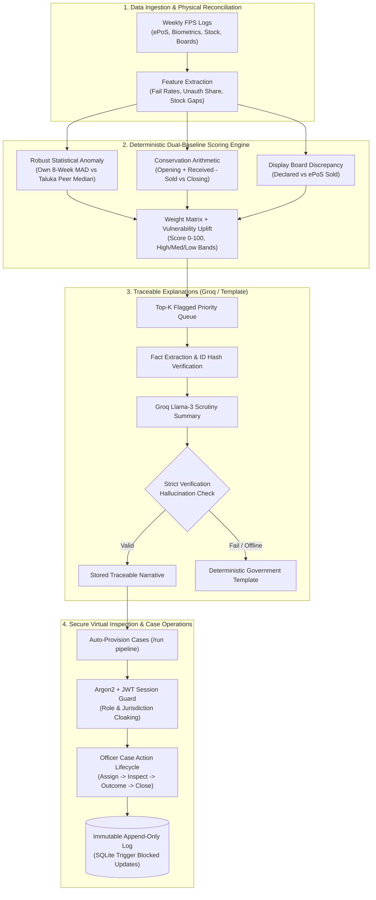
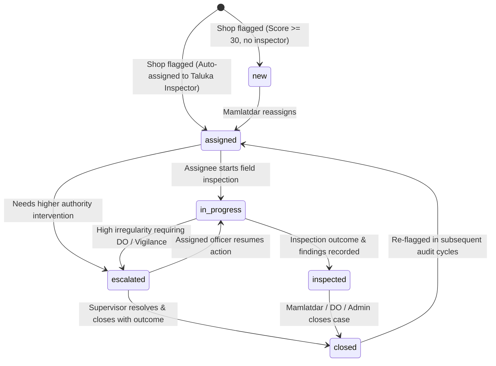
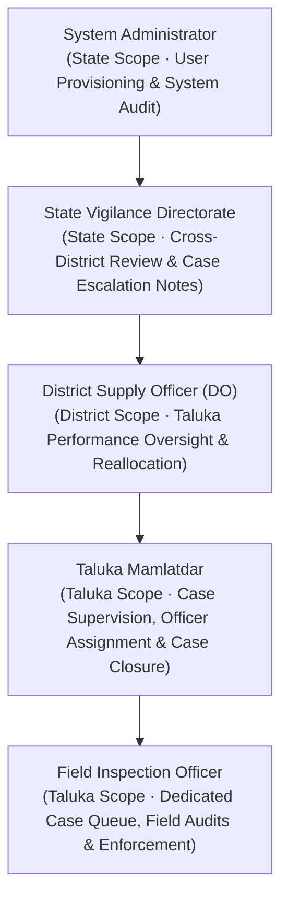

# 🌾 Gujarat PDS Virtual Inspection System (V2)

[](https://github.com/prempatel-ai/AI-Virtual-Inspection-System)
[](https://fastapi.tiangolo.com/)
[-black?style=flat-square&logo=next.js)](https://nextjs.org/)
[](https://www.typescriptlang.org/)
[](https://sqlite.org/)
[](scripts/check_contrast.py)
[]()

An enterprise virtual inspection and self-auditing intelligence platform designed for the **Department of Food, Civil Supplies & Consumer Affairs, Government of Gujarat**. 

The system continuously audits weekly transaction logs, biometric authentication attempts, physical stock reconciliations, and public display board filings across **17,000+ Fair Price Shops (FPS)** in Gujarat. By blending **robust statistical anomaly detection** with **hard physical conservation laws**, it isolates diversion and fraud while shielding honest shop owners from false positives during infrastructure blackouts.

---

## 🏛️ System Architecture Overview



---

## ⚡ Key Architectural Pillars

### 1. Dual-Baseline Anomaly Detection & Outage Trap Defense
Traditional audit systems fail because they flag entire regions whenever cellular or ePoS towers go offline. Our engine separates individual malfeasance from systemic telecom faults using a dual-baseline Median Absolute Deviation (MAD) framework:
- **Own History Baseline ($z_{\text{own}}$):** Evaluates whether the current week deviates from the shop's trailing 8-week operating baseline:
  $$z_{\text{own}} = \frac{x - \text{median}(x_{t-8..t})}{\max(1.4826 \times \text{MAD}(x_{t-8..t}),\, \sigma_{\min})}$$
- **Taluka Peer Baseline ($z_{\text{peer}}$):** Benchmarks against contemporaneous peers in the exact same taluka and shop-size tertile:
  $$z_{\text{peer}} = \frac{x - \text{median}(\text{peers}_t)}{\max(1.4826 \times \text{MAD}(\text{peers}_t),\, \sigma_{\min})}$$
- **Outage Trap Immunity:**
  $$\text{Signal Strength } s = \text{clip}\left(\frac{\min(z_{\text{own}}, z_{\text{peer}})}{z_{\text{cap}}},\, 0,\, 1\right)$$
  During a widespread tower outage in talukas like **Kadi (Mehsana)**, all local shops experience biometric failures simultaneously. This elevates the taluka peer median, pulling $z_{\text{peer}}$ toward zero and **suppressing false alarms completely**.

### 2. Hard Arithmetic Physical Conservation Checks
In addition to statistical rate anomalies, the engine enforces strict mass-conservation equations:
- **Stock Conservation Deficit:**
  $$\Delta_{\text{stock}} = \frac{\left| \text{Opening} + \text{Received} - \text{Sold} - \text{Closing} \right|}{\text{Opening} + \text{Received}} \times 100$$
- **Public Display Board Discrepancy:**
  $$\Delta_{\text{board}} = \frac{\left| \text{Board Distributed} - \text{ePoS Sold} \right|}{\text{ePoS Sold}} \times 100$$
- **Vulnerability Uplift:** Vulnerable tribal or low-income clusters ($\text{VI} \ge 0.80$) automatically receive risk weighting priority to protect sensitive beneficiary quotas.

### 3. Tamper-Proof Append-Only Audit Trail
Regulatory inspection systems require unassailable evidence. Every action taken on a case—from inspection commencement to outcome findings and penalties—is recorded with cryptographic finality:
- Underpinned by **SQLite database triggers** that explicitly block any `UPDATE` or `DELETE` operations on `case_actions` and `audit_log`.
- Even database administrators cannot alter historically filed inspection findings or penalty orders without breaking trigger constraints.

---

## 🛡️ Case Management State Machine

Every flagged shop automatically initializes a tracked investigation case governed by a strict server-side state machine (**409 Conflict** on illegal transitions):



---

## 👥 Multi-Tier Administrative Roles & Jurisdiction Scoping

The system mirrors the actual administrative hierarchy of Gujarat across **8 Districts** and **69 Authentic Talukas**:



### Jurisdiction Security Principles:
1. **Deny by Default:** No endpoint or resource is accessible without explicit capability claims.
2. **Existence Cloaking (404 over 403):** If an Inspector in *Sanand (Ahmedabad)* attempts to access a case in *Kadi (Mehsana)*, the system returns a **404 Not Found** instead of a 403, preventing enumeration of state enforcement actions.
3. **Dynamic Action Authority:** Action buttons in the UI are never rendered via hardcoded client-side role checks. The server computes and returns `allowed_actions: []` based on case status, active user ID, and assigned jurisdiction.

---

## 💻 Tech Stack & Engineering Standards

| Layer | Technology | Key Capabilities & Patterns |
|---|---|---|
| **Backend API** | **FastAPI (Python 3.11 / 3.13)** | Async ASGI, Pydantic v2 data contracts, Argon2 password hashing, PyJWT, connection pooling, zero-leak error boundaries. |
| **Database** | **SQLite (WAL mode)** | Single-file embedded zero-latency architecture, foreign key integrity, append-only security triggers. |
| **Statistical Engine** | **NumPy & Pandas** | Vectorized rolling MAD window computation, lognormal transaction distributions, deterministic seeded generation. |
| **LLM Explainer** | **Groq Python SDK (Llama-3)** | Strict numeric fact validation, SHA-256 fact hashing, guaranteed deterministic template fallback. |
| **Frontend Web** | **Next.js 14 (App Router)** | React 18 Server/Client components, dynamic streaming, responsive layouts (1280px desktop, 768px tablet). |
| **UI & Styling** | **Tailwind CSS & CSS Tokens** | Zero AI-slop design: 100% WCAG AA contrast, custom multi-sort datatables, CSV export, skeleton loaders. |
| **Quality & Tests** | **Pytest, Vitest, Ruff, Mypy** | 169 backend unit/RBAC matrix tests, 39 frontend unit/integration tests, full type-safety. |

---

## 🚀 Quickstart & Single-Command Launch

### Prerequisites
- **Python 3.11+** (Python 3.13 fully supported)
- **Node.js 18+** (Node 20 LTS recommended)
- Git & modern shell (PowerShell or Bash)

### 1. Automated Setup
Clone the repository and install all dependencies:
```bash
git clone https://github.com/prempatel-ai/AI-Virtual-Inspection-System.git
cd AI-Virtual-Inspection-System
make setup
```
*(On Windows systems without `make`: creates `.venv`, installs backend with `pip install -e "backend[dev]"`, and runs `npm install` inside `frontend/`)*

### 2. Launch the Demo Environment
Run the unified supervisor script. This automatically verifies the database, provisions seeded cases across Gujarat, and launches both services simultaneously:
```bash
python scripts/demo.py
# or: make demo
```

Once running:
- 🌐 **Web Interface:** [http://localhost:3000](http://localhost:3000)
- 📑 **Interactive OpenAPI Docs:** [http://localhost:8000/docs](http://localhost:8000/docs)
- 🧭 **7-Minute Guided Walkthrough:** [`docs/DEMO.md`](docs/DEMO.md)

---

## 🔑 Demo Personas & Pre-Seeded Scenarios

The system comes pre-seeded with 149 realistic administrative officers across Gujarat. Use the password **`demoPassword123`** (or quick-sign-in buttons on the login screen):

| Role | Demo Account | Jurisdiction Scope | Core Responsibilities |
|---|---|---|---|
| **Inspector** | `ananya.patel.13@demo.invalid` | Ahmedabad • Ahmedabad City | Work assigned queue, start inspections, submit outcome verification. |
| **Mamlatdar** | `saanvi.patel.12@demo.invalid` | Ahmedabad • Ahmedabad City | Supervise taluka queue, reassign inspectors, close completed cases. |
| **District Officer** | `vihaan.patel.4@demo.invalid` | Ahmedabad District | District-wide oversight, cross-taluka flag metrics, escalate severe cases. |
| **State Vigilance** | `vivaan.patel.2@demo.invalid` | State-wide (Gujarat) | State audit oversight, read-only case inspection, append formal notes. |
| **System Admin** | `aarav.patel.1@demo.invalid` | State-wide (Gujarat) | Officer provisioning, credentials reset, tamper-proof security access log. |

### Featured Inspection Walkthrough Scenarios:
- **`FPS-00183` (Mehsana):** Physical Stock Diversion (unaccounted closing stock deficit >12%).
- **`FPS-00125` (Patan):** Display Board Discrepancy (declared board kg exceeds ePoS records by 28%).
- **`FPS-00122` (Mehsana):** Biometric Override Surge (unauthenticated transactions 4x peer median).
- **`FPS-00001` (Mehsana):** Citizen Complaint Spike (short weight and denied ration reports).
- **`FPS-00167` (Mehsana):** Multi-Signal Severe Case (stock deficit + overrides + complaints).
- **`Kadi Taluka` (Mehsana):** **The Outage Trap** (cellular tower collapse isolated and suppressed from false alarms).

---

## 🧪 Comprehensive Quality Gates

Every layer of the codebase is verified by automated quality commands:

```bash
# Run the entire test & verification suite:
make check
```

The validation suite executes:
1. **Backend Code Quality:** `ruff check backend` (zero lint warnings).
2. **Backend Type Integrity:** `mypy backend/app` (strict static typing).
3. **Frontend Code Quality:** `npm run lint` inside `frontend/` (Next.js ESLint).
4. **Frontend Type Integrity:** `npm run typecheck` inside `frontend/` (TypeScript `tsc --noEmit`).
5. **Backend Unit & RBAC Tests:** `pytest backend/tests` (169 passed, including 55 RBAC matrix cases).
6. **Frontend Unit & Component Tests:** `npm run test` inside `frontend/` (39 Vitest tests passed).
7. **Accessibility & Contrast Verification:** `python scripts/check_contrast.py` (16 color pairs verified against WCAG AA $\ge 4.5:1$).

---

## 📁 Repository Layout

```
├── backend/
│   ├── app/
│   │   ├── api/             # FastAPI routers (auth, cases, oversight, admin, routes)
│   │   ├── auth/            # Security (Argon2, JWT cookies, CSRF, lockout guard)
│   │   ├── data/            # Generator, scenario planter & user/activity seeders
│   │   ├── detection/       # Dual-baseline MAD z-score engine & stock reconciliation
│   │   ├── llm/             # Fact extraction, Groq Llama-3 client & failsafe templates
│   │   ├── pipeline/        # Weekly audit execution, case provisioning & metrics
│   │   └── scoring/         # Score decomposition & vulnerability index uplifts
│   └── tests/               # 169 pytest tests (including test_rbac_matrix.py)
├── frontend/
│   ├── app/                 # Next.js App Router (queue, cases, areas, officers, admin)
│   ├── components/ui/       # Enterprise UI blocks (DataTable, AppShell, RoleNav, Skeletons)
│   ├── lib/                 # Type-safe API client (SameSite cookies & CSRF handling)
│   ├── styles/tokens.css    # Design tokens (colors, spacing, typography, light mode)
│   └── tests/               # Vitest suite (screen components, state machines, navigation)
├── docs/
│   ├── ARCHITECTURE.md      # Data flow, state machine & security architecture
│   ├── DEMO.md              # Step-by-step 7-minute evaluator walkthrough
│   ├── DESIGN.md            # Enterprise UX rules, contrast tokens & design system
│   └── PRODUCT.md           # Business objectives, operational requirements & scope
├── scripts/
│   ├── demo.py              # Single-command environment runner & supervisor
│   ├── check_contrast.py    # Automated WCAG 2.1 AA token contrast auditor
│   └── perf.py              # 17,000-shop performance & throughput benchmark
└── Makefile                 # Build orchestration (setup, check, data, demo)
```

---

## 👨‍💻 Engineering & Ownership

Engineered and maintained with care by **Prem Patel** ([rolexhere03@gmail.com](mailto:rolexhere03@gmail.com)).
Built for transparent, accountable, and resilient public ration governance.
