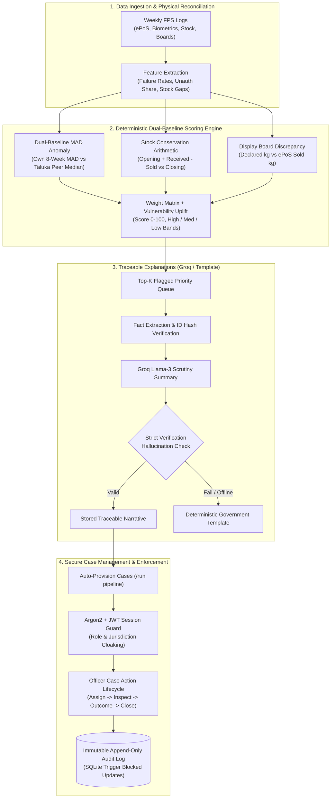
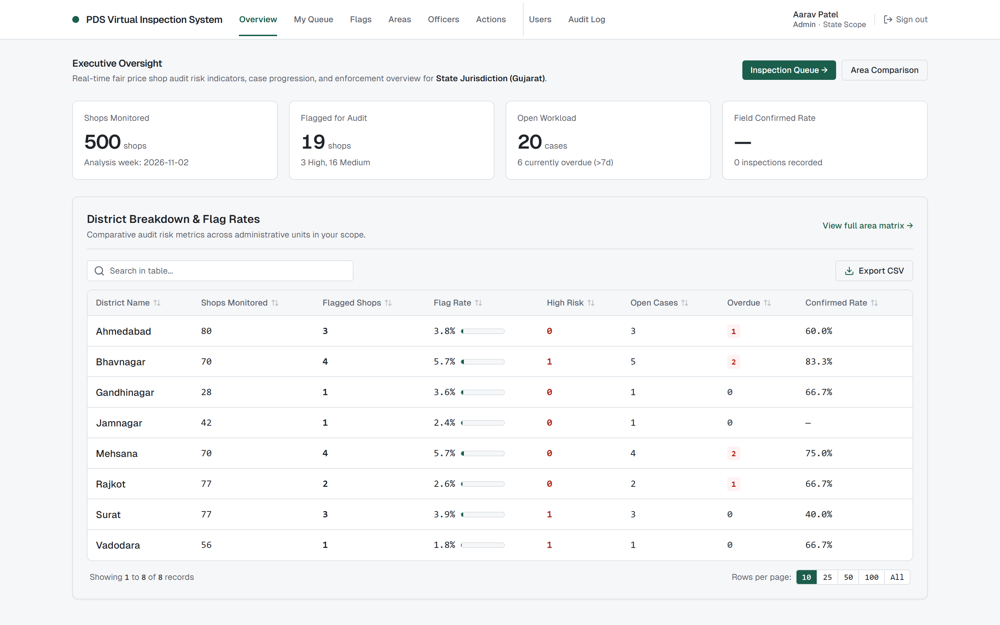
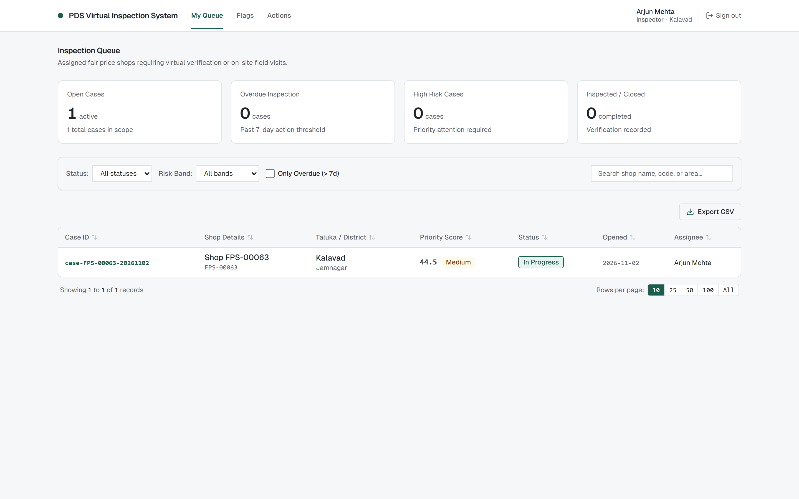
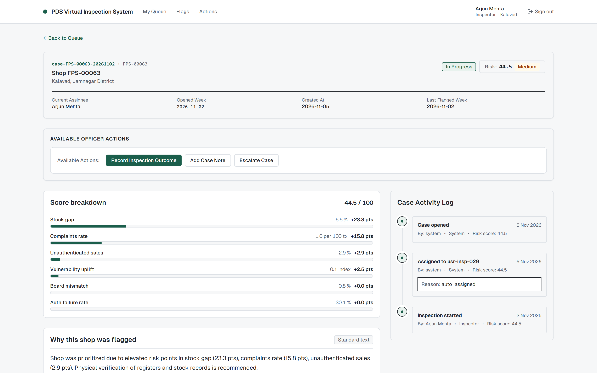
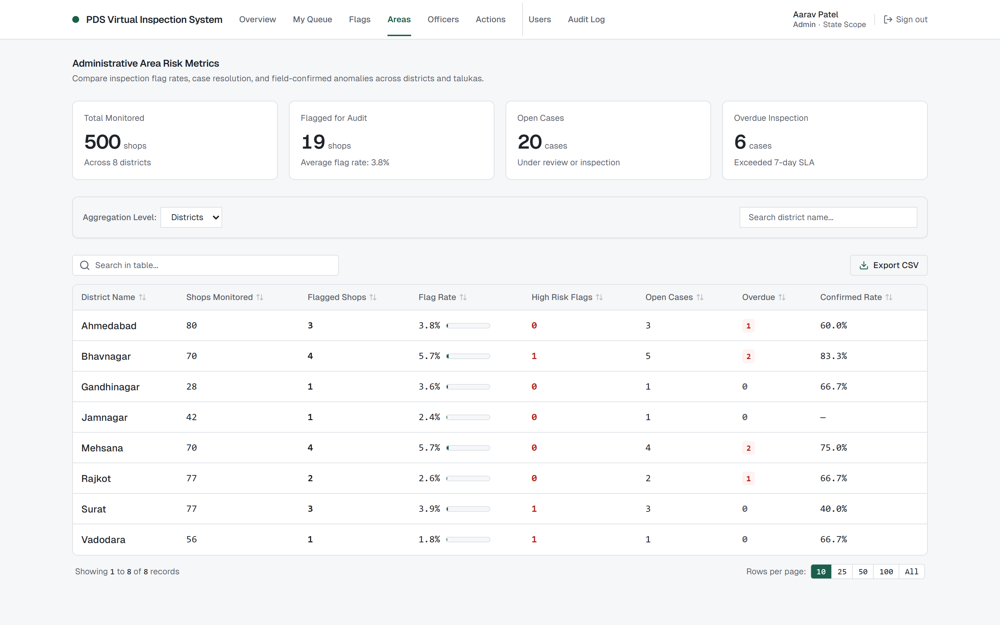
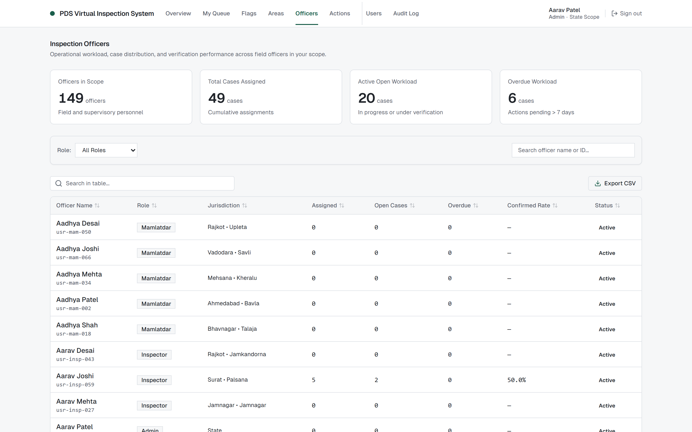
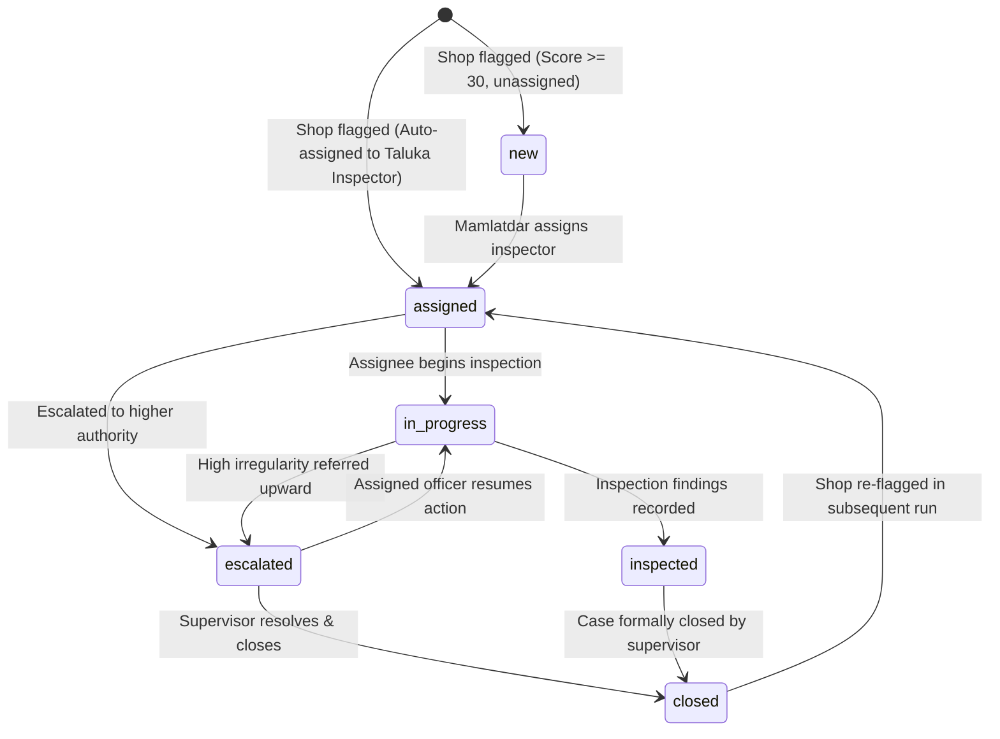
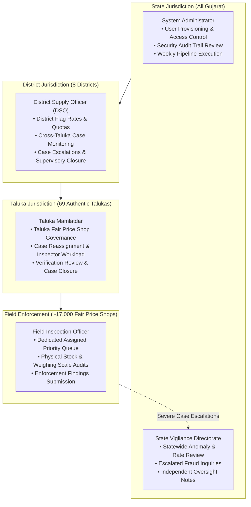

# Gujarat PDS Virtual Inspection System (V2)

[](https://github.com/prempatel-ai/AI-Virtual-Inspection-System)
[](https://fastapi.tiangolo.com/)
[-black?style=flat-square&logo=next.js)](https://nextjs.org/)
[](https://www.typescriptlang.org/)
[](https://sqlite.org/)
[](scripts/check_contrast.py)
[]()

An enterprise virtual inspection and self-auditing intelligence platform engineered for the **Department of Food, Civil Supplies & Consumer Affairs, Government of Gujarat**.

The system audits weekly transactions, biometric authorizations, stock conservation reconciliations, and public display boards across **17,000+ Fair Price Shops (FPS)** in Gujarat. By combining deterministic dual-baseline anomaly detection with hard mass-conservation checks, it isolates fraudulent grain diversion while shielding honest shop dealers from false alarms during telecom infrastructure outages.

---

## System Architecture



---

## Application Walkthrough & Core Screens

### 1. Executive Oversight & Statewide Metrics


- **Key Performance Indicators**: Statewide monitoring across shops monitored, active flagged cases, overdue investigations (>7 days), and confirmed on-site irregularity rates.
- **District Risk Matrix**: Real-time comparative ranking of all 8 Gujarat administrative districts by flag rate, high-risk case load, open cases, and field confirmation percentages.

---

### 2. Inspector Case Queue & Priority Worklist


- **Dedicated Case Queue**: Automatically filtered to shops assigned to the logged-in officer within their active taluka jurisdiction.
- **Multi-Column Sorting & Instant Search**: Sort dynamically by Risk Score, Days Open, Status, or Taluka. Filter down to individual shop names or IDs.
- **Adjustable Page Sizing**: Switch effortlessly between 10, 25, 50, or 100 cases per page with built-in CSV roster export.

---

### 3. Case Investigation & Field Action Controls


- **Exact Score Breakdown**: Displays the exact point contribution for each signal (Biometric overrides, stock deficit, board mismatch, citizen complaints, and vulnerability uplift).
- **Physical Verification Checklist**: Standardized inspection fields including physical stock audit counts, weighing scale calibration seal checks, and beneficiary ration slip audits.
- **Server-Governed Action Bar**: Action buttons are rendered strictly from server-authorized capabilities (`start_inspection`, `record_outcome`, `escalate`, `reassign`, `close`).
- **Tamper-Proof Audit Timeline**: Reverse-chronological history showing every inspector action, notes, and outcome, protected by SQLite database triggers.

---

### 4. Administrative Area Risk Matrix


- **Multi-Level Administrative Drill-Down**: Switch between District view and Taluka view to compare performance metrics across levels of administration.
- **69 Authentic Gujarat Talukas**: Full coverage of all official Gujarat talukas (Sanand, Daskroi, Kadi, Gondal, Jetpur, etc.) without placeholder naming.

---

### 5. Officer Workload & Security Roster


- **Workload & Response Tracking**: Monitors assigned case counts, overdue rates (>7 days), and median response turnaround times per officer.
- **Security Scope Inspection**: Detailed view of each officer's operational credentials, assigned administrative scope, and role permissions.

---

## Detection Engine & Outage Trap Defense

Traditional auditing systems produce heavy false alarms whenever regional telecommunications go down. This platform isolates fraud using a dual-baseline Median Absolute Deviation (MAD) model coupled with physical conservation arithmetic.

### 1. Dual-Baseline Anomaly Calculation

```
Own History Baseline (z_own):
  z_own = (x - median(own_history)) / max(1.4826 * MAD(own_history), min_scale)

Taluka Peer Baseline (z_peer):
  z_peer = (x - median(peer_group)) / max(1.4826 * MAD(peer_group), min_scale)

Combined Signal Strength:
  signal = clip(min(z_own, z_peer) / 4.0, 0.0, 1.0)
```

- **Own History (z_own)**: Compares current weekly behavior against the shop's trailing 8-week operating baseline.
- **Taluka Peer Group (z_peer)**: Benchmarks the shop against contemporaneous peers operating in the exact same taluka and shop-size tertile.
- **Minimum Intersection**: Taking the minimum of both z-scores ensures that a shop is flagged only when it deviates from **both** its own normal behavior and its local peers.

### 2. Outage Trap Defense (Zero False Alarms)

```
Scenario: Regional cellular tower failure in Kadi Taluka (Mehsana)

Normal Week:
  - Local shops report ~2-4% biometric auth failures.
  - Peer median auth failure = ~3.0%.

Outage Week:
  - Tower failure causes auth failures across all shops in Kadi to spike to ~35-45%.
  - Taluka peer median shifts upward to ~38.0%.
  - Result: (x - median(peers)) remains near 0 -> z_peer <= 0.5.
  - Signal strength collapses to zero -> No false cases opened.
```

### 3. Physical Conservation & Hard Signal Equations

| Signal Key | Signal Type | Mathematical Definition | Failure Condition |
|---|---|---|---|
| `stock_gap_pct` | Hard Arithmetic | `abs(Opening + Received - Sold - Closing) / (Opening + Received) * 100` | Unaccounted stock deficit > 5% |
| `board_mismatch_pct` | Hard Arithmetic | `abs(Board Distributed - ePoS Sold) / ePoS Sold * 100` | Public board differs from ePoS by > 10% |
| `auth_fail_rate` | Rate Anomaly | `auth_failures / auth_attempts` | Elevated vs own history AND taluka peers |
| `unauth_share` | Rate Anomaly | `unauth_sales / transactions` | Elevated unauthenticated sales vs peers |
| `complaints_rate` | Citizen Signal | `complaints_count / transactions * 100` | Spike in short weight or denied rations |

---

## Case Lifecycle & State Machine

Every flagged shop automatically opens or updates a case governed by a strict server-side state machine. Illegal transitions return **HTTP 409 Conflict**.



### Transition Authority Rules:
- **start_inspection & record_outcome**: Exclusively executable by the case's current assignee.
- **reassign & close**: Authorized for Taluka Mamlatdars, District Officers, and Administrators.
- **escalate**: Follows administrative hierarchy: Inspector -> Mamlatdar -> District Officer -> State Vigilance.
- **add_note**: Permitted across all open states by authorized personnel (including Vigilance).

---

## Multi-Tier Administrative Roles & Jurisdiction Scoping

The platform mirrors the statutory governance hierarchy of the Gujarat Food & Civil Supplies Department across 8 Districts and 69 Authentic Talukas:



| Role | Geographic Scope | Queue Access | Case Actions Permitted | Administrative Privileges |
|---|---|---|---|---|
| **Inspector** | Single Taluka | Assigned cases only | Start, Record Outcome, Add Note, Escalate | None |
| **Mamlatdar** | Single Taluka | All cases in taluka | Reassign, Add Note, Escalate, Close | Taluka officer roster |
| **District Officer** | Entire District | All cases in district | Reassign, Add Note, Escalate, Close | District area matrix & officers |
| **State Vigilance** | Entire State | All cases in state | Add Note (read-only audit oversight) | State oversight dashboards |
| **System Admin** | Entire State | Full administrative view | Reassign, Close, Run Pipeline | User provisioning & audit log |

### Security Highlights:
- **Existence Cloaking (404 Not Found)**: Out-of-scope requests return 404 rather than 403, preventing unauthorized existence discovery across jurisdictions.
- **Tamper-Proof Triggers**: SQLite database triggers block all `UPDATE` and `DELETE` commands on `case_actions` and `audit_log`.
- **Session Security**: Passwords hashed using Argon2id. Sessions verified with signed JWTs stored in `HttpOnly`, `SameSite=Lax` cookies with CSRF validation.

---

## Pre-Seeded Evaluation Accounts

The platform includes 149 pre-configured administrative personnel across Gujarat. Use the password **`demoPassword123`** (or click the quick demo buttons on the login page):

| Role | Account Email | Assigned Geographic Jurisdiction |
|---|---|---|
| **Field Inspector** | `ananya.patel.13@demo.invalid` | Ahmedabad District • Ahmedabad City Taluka |
| **Taluka Mamlatdar** | `saanvi.patel.12@demo.invalid` | Ahmedabad District • Ahmedabad City Taluka |
| **District Officer** | `vihaan.patel.4@demo.invalid` | Ahmedabad District (District-Wide) |
| **State Vigilance** | `vivaan.patel.2@demo.invalid` | State of Gujarat (State-Wide Oversight) |
| **System Administrator** | `aarav.patel.1@demo.invalid` | State of Gujarat (System Administration) |

---

## Pre-Seeded Walkthrough Scenarios

| Scenario ID | Planted Shop | Location | Signal Pattern | Primary Evidence |
|---|---|---|---|---|
| **S1 Stock Diversion** | `FPS-00183` | Mehsana | Closing stock deficit | 437 kg physical grain deficit vs book ledger |
| **S2 Board Mismatch** | `FPS-00125` | Patan | Display board discrepancy | Public board displays 28% higher grain than ePoS sales |
| **S3 Override Spike** | `FPS-00122` | Mehsana | Biometric override surge | Unauthenticated transactions 4x local peer median |
| **S4 Complaint Surge** | `FPS-00001` | Mehsana | Citizen grievance spike | 14 citizen complaints regarding denied rations |
| **S5 Multi-Signal** | `FPS-00167` | Mehsana | Compound severe fraud | Stock deficit + biometric overrides + complaint surge |
| **S6 Vulnerable Shop** | `FPS-00131` | Mehsana | Vulnerability index uplift | Low-income cluster (VI: 0.88) with mild stock gap |
| **S7 Outage Trap** | All shops | Kadi (Mehsana) | Telecom tower blackout | **Zero false alarms**; peer median protects clean shops |

---

## Quickstart & Launch Commands

### Prerequisites
- Python 3.11+ (Python 3.13 fully supported)
- Node.js 18+ (Node 20 LTS recommended)
- Git and command-line shell

### 1. Installation
```bash
git clone https://github.com/prempatel-ai/AI-Virtual-Inspection-System.git
cd AI-Virtual-Inspection-System
make setup
```

### 2. Launch Application
Launch both backend and frontend servers with a single command:
```bash
python scripts/demo.py
# or: make demo
```

Access the system:
- **Web Interface**: [http://localhost:3000](http://localhost:3000)
- **API Documentation**: [http://localhost:8000/docs](http://localhost:8000/docs)
- **Evaluation Guide**: [`docs/DEMO.md`](docs/DEMO.md)

---

## Quality Gates & Verification

Run the full automated verification test suite:

```bash
make check
```

Automated checks executed:
- `ruff check backend`: Python linting (0 errors).
- `mypy backend/app`: Python type verification (0 errors).
- `npm run lint` (frontend): ESLint code style audit (0 warnings).
- `npm run typecheck` (frontend): TypeScript static typechecking (0 errors).
- `pytest backend/tests`: 169 backend unit and RBAC matrix tests (100% pass).
- `npm run test` (frontend): 39 Vitest UI component and integration tests (100% pass).
- `python scripts/check_contrast.py`: WCAG 2.1 AA color contrast verification (16/16 pass).

---

## Repository Structure

```
├── backend/
│   ├── app/
│   │   ├── api/             # FastAPI routers (auth, cases, oversight, admin)
│   │   ├── auth/            # Argon2 password security, JWT cookies, RBAC dependencies
│   │   ├── data/            # Synthetic data generation, 69 talukas & user seeders
│   │   ├── detection/       # Dual-baseline MAD z-score engine & stock reconciliation
│   │   ├── llm/             # Fact extraction, Groq Llama-3 client & fallback templates
│   │   ├── pipeline/        # Weekly audit execution, case provisioning & metrics
│   │   └── scoring/         # Score decomposition & vulnerability index uplifts
│   └── tests/               # 169 pytest tests (including test_rbac_matrix.py)
├── frontend/
│   ├── app/                 # Next.js App Router (overview, queue, cases, areas, officers)
│   ├── components/ui/       # Enterprise UI components (DataTable, AppShell, Skeletons)
│   ├── lib/                 # Type-safe API client (SameSite cookies & CSRF headers)
│   ├── styles/tokens.css    # Central design tokens (light-theme palette, contrast AA)
│   └── tests/               # Vitest suite (screen components, state machines, forms)
├── docs/
│   ├── images/              # High-resolution screenshots of running system screens
│   ├── ARCHITECTURE.md      # Detailed system flow, data models & security contracts
│   ├── DEMO.md              # 7-minute evaluator walkthrough guide
│   ├── DESIGN.md            # UX principles, color tokens & banned UI patterns
│   └── PRODUCT.md           # Product specifications & statutory audit background
├── scripts/
│   ├── demo.py              # Single-command environment runner & supervisor
│   ├── check_contrast.py    # Automated WCAG 2.1 AA token contrast auditor
│   └── capture_screenshots.js # Automated Playwright screen capture script
└── Makefile                 # Orchestration targets (setup, check, demo, data)
```

---

## Author & Maintainer

Maintained by **Prem Patel** ([rolexhere03@gmail.com](mailto:rolexhere03@gmail.com)).  
Built for transparent, accountable, and tamper-proof public distribution monitoring.
